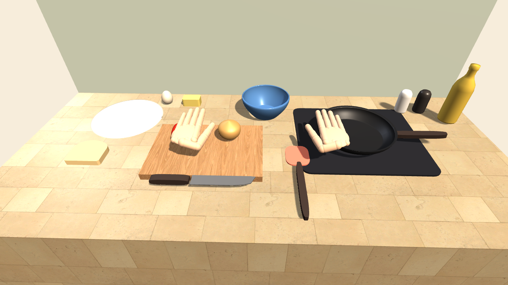

# let's cook! 🍳🧤

A free-play cooking sandbox you play with your hands: Rokoko Smartgloves, your webcam, or just the mouse. Cook anything: slice, crack eggs, oil the pan, season, toast, burn things. When you serve a plate, Claude names the dish, decides which course it is, and unlocks a personal next recipe. Need a tool that isn't there? Ask for it and it appears. Every motion can (with your consent) be saved as hand-motion data for training robots to cook.



**Quick start**
```bash
python3 -m venv .venv && .venv/bin/pip install lz4 pytest numpy pyarrow anthropic mediapipe opencv-python
./start.sh                       # logger + chef server (Claude; needs ANTHROPIC_API_KEY)
.venv/bin/python hand_cam.py     # optional: play with your webcam instead of gloves
```
Then open `LetsCook/` in Unity 6 (6000.2.9f1), open `Assets/Scenes/Kitchen.unity` and press Play, or build the app with `./unity.sh app`. Full guide: [HOW-TO-RUN.md](HOW-TO-RUN.md).

**Under the hood:** continuous cooking physics (surface water boils off before browning, Maillard browning above 140 °C, charring above 180 °C, egg proteins set at 62 °C, butter melts, oil smokes at 230 °C) · physics hands with assisted pinch grasp · knife cutting · robot-learning export (LeRobot-style dataset with 140-d hand state, object poses, contacts, frame-aligned video) · retargeting onto the LEAP robot hand.

Built on 2026-10-17.

## Start here
- [HOW-TO-RUN.md](HOW-TO-RUN.md): start the helpers, stream the gloves, play, export robot data
- [PROGRESS.md](PROGRESS.md): what was built on 2026-10-17, with test evidence
- [BUILD-PLAN.md](BUILD-PLAN.md): the recommended stack, phases, budget, risks
- [glove-setup.md](glove-setup.md): step-by-step Smartgloves setup checklist (do this first)
- [open-questions.md](open-questions.md): decisions still to make

## Context
- [vision.md](vision.md): what the game is and why, in the user's own words
- [robotics-data.md](robotics-data.md): short overview of the robot data side
- [tech-stack.md](tech-stack.md): what's installed on this Mac and what can't run on it
- [research-notes.md](research-notes.md): first-pass sources

## Deep research (2026-10-17)
- [research/rokoko-streaming.md](research/rokoko-streaming.md): Studio on Mac, pricing, JSON v3/v4 format, Command API, wrist-tracking options, Wi-Fi
- [research/cooking-sim-tech.md](research/cooking-sim-tech.md): engine, physics hands, grasping, slicing, liquids, cook-state model, MVP
- [research/ai-generation.md](research/ai-generation.md): text-to-3D, procedural tools, Unity import, AI physics, Claude naming/unlocks, voice
- [research/robot-data.md](research/robot-data.md): LeRobot format, MANO, retargeting, RoboCasa, consent, publishing

## Code
- `LetsCook/`: the Unity 6 game (scripts in `Assets/LetsCook/Scripts`)
- `start.sh`: starts the glove logger + chef server (`--mock` adds fake gloves)
- `receiver.py`: logs Rokoko Custom Streaming (UDP 14043) to `sessions/*.jsonl`
- `mock_glove.py`: fake JSON v4 glove stream
- `chef_server.py`: Claude names dishes, unlocks recipes, designs tools (port 8776)
- `tools_library.json`: instant tools
- `tools/to_lerobot.py`: session → LeRobot-style dataset
- `unity.sh`: batch-mode build / test / screenshot

## Status
- [ ] Phase 0: real gloves streaming (waiting on Rokoko Studio setup + streaming plan)
- [x] Phase 1: hands in Unity (from the glove stream, or mock hands)
- [x] Phase 2: grab anything (assisted pinch grasp)
- [x] Phase 3: first kitchen (cutting, heat, browning, plating)
- [x] Claude dish naming + unlocks (needs a valid API key), ask-for-any-tool
- [x] Robot data logging + LeRobot export
